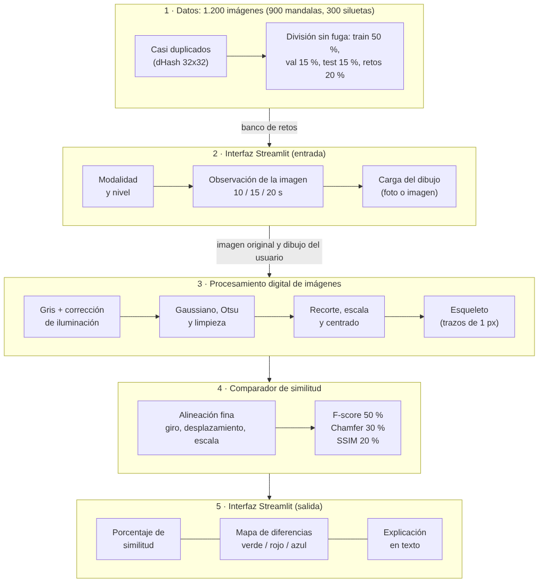
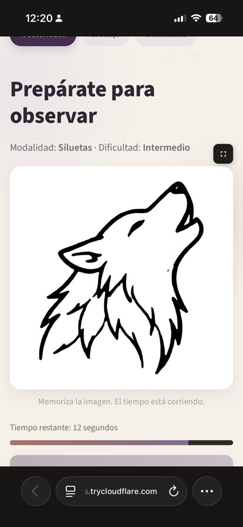
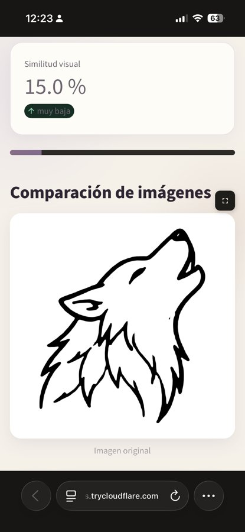
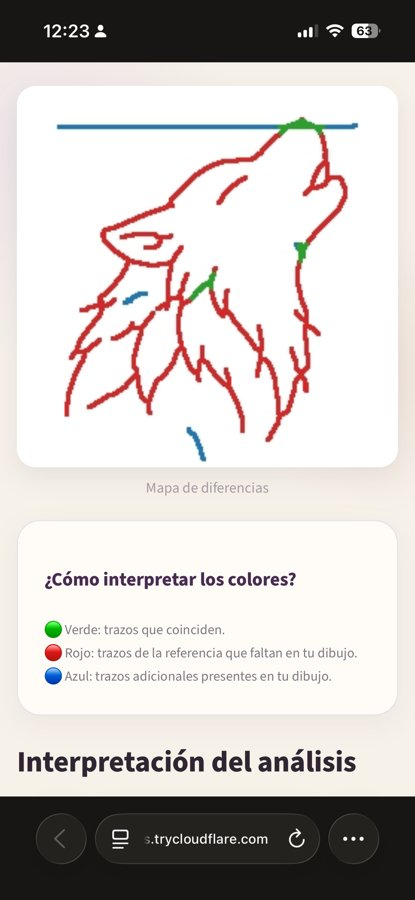
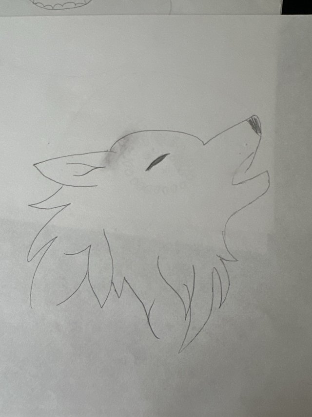
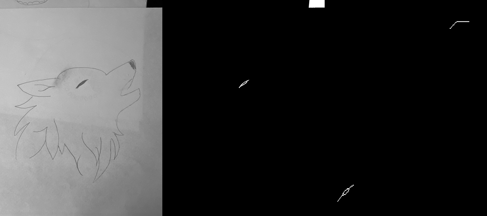
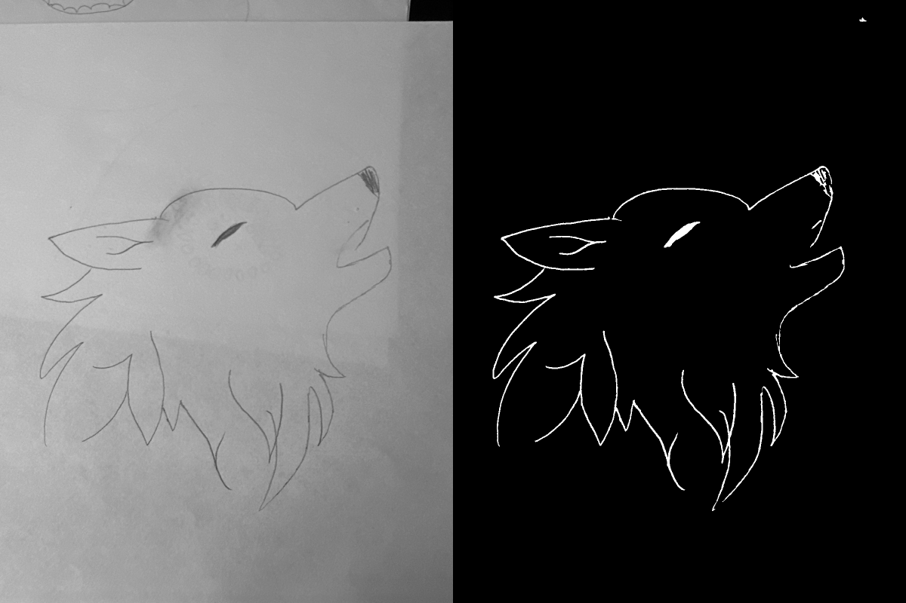

# TraceLab: memoria visual con procesamiento digital de imágenes

Proyecto final de **Procesamiento Digital de Imágenes** (2026-2).
Tema: *Análisis de la Expresión Humana en el Arte y la Cultura*.

> **Integrantes:** `[COMPLETAR: nombres]` · **Docente:** Nicolas Llanos Neuta
> **Video demostrativo (máx. 3 min):** `[COMPLETAR: enlace]` · **Póster:** `[COMPLETAR: enlace o archivo]` · **Datos:** `[COMPLETAR: enlace de Drive]`

---

## 1. Descripción del proyecto

### Problemática
Dibujar de memoria una imagen es una forma de expresión humana en la que se mezclan percepción, memoria y estilo personal. Mandalas y siluetas son motivos recurrentes del arte y la cultura, pero no existe una forma sencilla y objetiva de ver **qué tanto de una imagen se conserva** al reproducirla de memoria ni **qué partes** se olvidan, se cambian o se añaden.

### Justificación
Un comparador de trazos que explique sus resultados (no solo un número) permite usar el dibujo como una actividad de observación y reflexión sobre cómo se recuerda lo visual, con aplicaciones en educación artística y en actividades culturales interactivas.

### Objetivos
- **General:** diseñar, implementar y evaluar un sistema interactivo basado en procesamiento digital de imágenes y visión computacional que compare el dibujo de memoria de una persona con la imagen original.
- **Específicos:**
  1. Preparar y dividir un conjunto de 1.200 imágenes (mandalas y siluetas) sin fuga de datos.
  2. Implementar un pipeline de preprocesamiento y un comparador de similitud explicable.
  3. Construir una interfaz gráfica (Streamlit) que guíe el reto: observar, dibujar, subir y ver el resultado.
  4. Evaluar el comparador con métricas cuantitativas y analizar sus limitaciones.

### Solución propuesta
**TraceLab** muestra una imagen (mandala o silueta) durante 10, 15 o 20 segundos según el nivel. La persona la dibuja de memoria en papel o en digital, sube la foto y la app calcula un **porcentaje de similitud visual**, un **mapa de diferencias** (verde: coincide, rojo: falta, azul: sobra) y una **explicación en texto**.

---

## 2. Arquitectura del sistema



| Componente | Archivo | Función |
|---|---|---|
| Preprocesamiento | `app/procesamiento.py` | Carga, iluminación, binarización, recorte/escala/centrado, esqueleto |
| Comparador | `app/comparador.py` | Alineación fina, métricas, puntaje, mapa de diferencias, explicación |
| Interfaz | `app/app.py` | Pantallas de Streamlit y flujo del reto |
| Desarrollo y pruebas | `notebooks/TraceLab_Desarrollo.ipynb` | División del dataset, evaluación y generación de los módulos |

---

## 3. Metodología

1. **Casi duplicados y división del dataset.** Se calcula un hash de diferencias (dHash 32×32, 1.024 bits) y se agrupan imágenes con distancia de Hamming ≤ 69 (14 pares). Cada grupo queda completo en un mismo conjunto. La división es estratificada por modalidad y nivel: **train 50 %, val 15 %, test 15 %, retos 20 %**. Se verificó que no hay pares casi duplicados en conjuntos distintos.
2. **Preprocesamiento.** Gris → corrección de iluminación (para fotos) → filtro gaussiano → binarización de Otsu → eliminación de motas → recorte, escala y centrado en un lienzo de 256×256 → esqueletización (trazos de 1 px).
3. **Comparador de similitud.** Primero una **alineación fina** (giros ±4°, desplazamientos ±5 px, escalas ±5 %). El puntaje combina tres medidas:
   - **F-score de trazos (50 %)**: cobertura y precisión con tolerancia de 4 px.
   - **Chamfer (30 %)**: distancia media entre trazos, convertida con `exp(-d/8)`.
   - **SSIM (20 %)**: estructura global sobre trazos suavizados.
4. **Por qué sin red neuronal.** No existían dibujos humanos para entrenar una red siamesa, y un método clásico se puede explicar mostrando qué coincide. Se deja el aprendizaje como trabajo futuro.
5. **Evaluación.** Pruebas sintéticas (desplazar, escalar, rotar, engrosar, ruido, temblor, borrar partes) frente a un control negativo (otra imagen). Los parámetros se exploraron en *val* y el resultado final se reportó en *test*.

---

## 4. Datos

- **Total:** 1.200 imágenes. Mandalas: 300 por nivel (fácil, intermedio, difícil). Siluetas: 100 por nivel.
- **División:** ver `notebooks/TraceLab_Desarrollo.ipynb` (sección 2). El archivo `division_dataset_v2.csv` se genera con la semilla 42.
- **Procedencia y licencia:** `[COMPLETAR: fuente de las imágenes y permisos]`.
- **Acceso:** `[COMPLETAR: enlace de Drive con permiso de lectura]`.
- **Dibujos de personas:** se guardan solo con consentimiento y de forma anónima, y **no se publican** en este repositorio.

Más detalle en [`data/README.md`](data/README.md).

---

## 5. Interfaz gráfica de usuario

Pantallas: inicio → modalidad → nivel → observación (cuenta regresiva) → carga del dibujo → resultados.

| Observación | Resultado | Mapa de diferencias |
|---|---|---|
|  |  |  |

**Cómo usarla**
1. Pulsa *Comenzar*, elige **Mandalas** o **Siluetas** y un nivel.
2. Pulsa *Mostrar imagen* y memorízala. Desaparece al terminar el tiempo.
3. Dibuja lo que recuerdes, tómale una foto con buena luz y súbela (JPG, JPEG o PNG).
4. Opcionalmente marca la casilla de consentimiento para guardar tu dibujo de forma anónima.
5. Pulsa *Analizar mi dibujo* y revisa el porcentaje, el mapa y la explicación.

---

## 6. Resultados

### 6.1 Evaluación final en *test* (pruebas sintéticas)

| Modalidad | Nivel | AUC | Puntaje medio alteradas | Puntaje medio imagen distinta |
|---|---|---|---|---|
| Mandalas | Fácil | 0.936 | 87.1 | 51.1 |
| Mandalas | Intermedio | 0.937 | 88.2 | 58.7 |
| Mandalas | Difícil | 0.906 | 89.3 | 70.1 |
| Siluetas | Fácil | 1.000 | 92.1 | 30.0 |
| Siluetas | Intermedio | 1.000 | 91.5 | 33.9 |
| Siluetas | Difícil | 0.994 | 92.0 | 48.4 |

Por estrato hay 150 reproducciones alteradas (10 tipos × 15 imágenes, **incluida la copia idéntica**) y 15 comparaciones con una imagen distinta. El AUC mide con qué frecuencia una reproducción alterada obtiene más puntaje que una imagen distinta.

### 6.2 Puntaje medio por tipo de alteración (*val*, sintético)

| Alteración | Mandalas | Siluetas |
|---|---|---|
| Idéntica | 100.0 | 100.0 |
| Ruido | 99.4 | 99.8 |
| Escalado pequeño | 97.7 | 99.3 |
| Rotación leve | 96.7 | 93.5 |
| Desplazamiento | 95.0 | 99.6 |
| Trazos omitidos | 93.9 | 92.3 |
| Trazo grueso | 92.9 | 93.9 |
| Temblor | 77.9 | 79.0 |
| Combinado | 66.8 | 68.9 |
| Escalado grande | 61.3 | 93.7 |
| **Imagen distinta (control)** | **58.6** | **36.2** |

### 6.3 Ejemplo con un dibujo real (análisis de errores)

Una foto a lápiz de un lobo (siluetas, nivel intermedio) obtuvo **15 %** de similitud (*muy baja*) aunque el dibujo se parece visualmente al original.

| Dibujo real (foto) | Qué detectó el preprocesamiento |
|---|---|
|  |  |

**Causa:** la binarización de Otsu solo detectó 72 píxeles de trazo, el ojo y una mancha del borde oscuro de la foto, y no el contorno fino a lápiz. Una variante con realce de líneas finas (*black-hat*) recupera el contorno completo.



Con esa variante, y tomando la captura de la app como referencia aproximada, el puntaje estimado sube de 13 % a unos 39 % (49 % con tolerancia de 8 px y 57 % con 12 px). Es un **solo caso**, por lo que se reporta como hallazgo y no como resultado general.

---

## 7. Conclusiones

- En *test*, el comparador separa una imagen alterada de una distinta (AUC de 0.91 a 0.94 en mandalas y de 0.99 a 1.00 en siluetas).
- Es robusto a desplazamiento, escala, ruido y rotación leve, y más sensible a temblor y alteraciones combinadas. Su punto débil son las mandalas difíciles.
- La primera prueba con un dibujo real dio 15 % pese a la similitud visual, por un fallo del preprocesamiento y no por la calidad del dibujo.

### Limitaciones
- La validación es casi solo sintética; falta una muestra de dibujos reales con valoraciones humanas.
- La binarización falla con líneas finas de lápiz y con fondos de foto (bordes de hoja, sombras).
- La tolerancia fija de 4 px es estricta para dibujos hechos de memoria.
- El despliegue actual depende de Google Colab y de un túnel temporal.

### Mejoras y trabajo futuro
- Mejorar el preprocesamiento para fotos (realce de líneas finas, recorte de la hoja).
- Avisar al usuario cuando se detecten muy pocos trazos.
- Calibrar tolerancia y pesos con dibujos reales y valoraciones humanas (correlación de Spearman).
- Evaluar un modelo aprendido (red siamesa) cuando haya suficientes pares humanos.
- Desplegar la app de forma estable.

---

## 8. Instalación y ejecución

**Requisitos:** Python 3.10 o superior y el conjunto de datos descargado (ver sección 4).

```bash
git clone <URL-de-este-repositorio>
cd TraceLab
pip install -r requirements.txt
```

La app espera esta estructura de carpetas (la ruta raíz se indica con la variable `TRACELAB_RAIZ`):

```
<RAIZ>/
├── Dataset/
│   ├── mandalas/{facil,intermedio,dificil}/*.png
│   └── siluetas/{facil,intermedio,dificil}/*.png
└── documentacion/division_dataset_v2.csv
```

```bash
# Linux / macOS
export TRACELAB_RAIZ="/ruta/a/Proyecto Final - Tracelab"
streamlit run app/app.py
```

```powershell
# Windows (PowerShell)
$env:TRACELAB_RAIZ = "C:\ruta\a\Proyecto Final - Tracelab"
streamlit run app/app.py
```

**En Google Colab:** abre `notebooks/TraceLab_Desarrollo.ipynb`, monta tu Drive y ejecuta las celdas en orden. Las secciones 7.1 a 7.3 escriben la app y la abren con un túnel de cloudflared.

---

## 9. Estructura del repositorio

```
TraceLab/
├── README.md
├── requirements.txt
├── app/                 # código fuente de la app
│   ├── app.py
│   ├── procesamiento.py
│   └── comparador.py
├── notebooks/           # desarrollo, división del dataset y evaluación
│   └── TraceLab_Desarrollo.ipynb
├── data/README.md       # descripción del dataset y enlace
└── docs/img/            # diagrama de arquitectura y capturas
```
