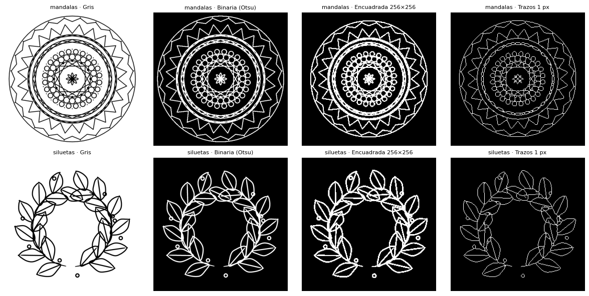
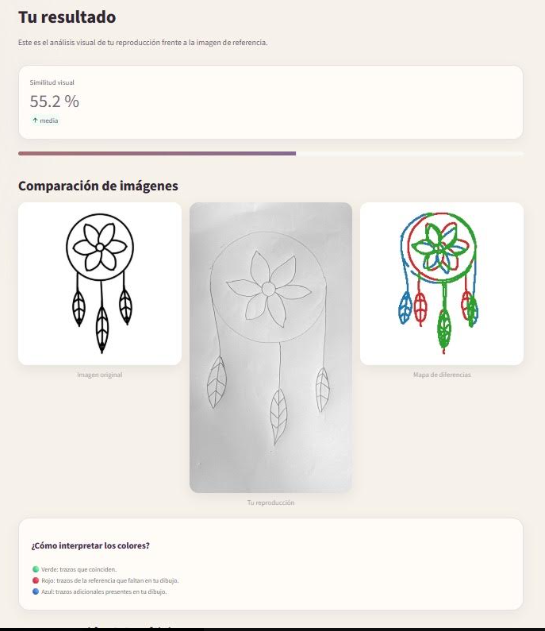
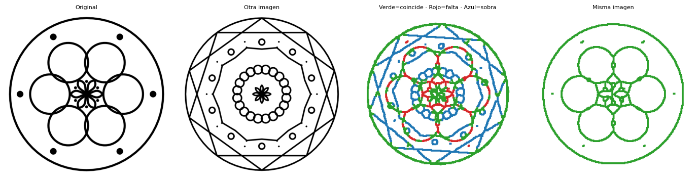
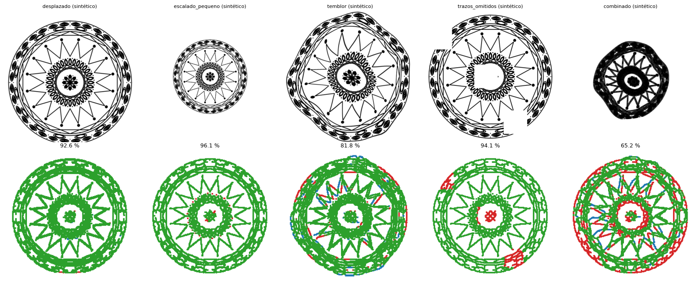

# TraceLab: memoria visual con procesamiento digital de imágenes

Proyecto final de **Procesamiento Digital de Imágenes** (2026-2). Tema: *Análisis de la Expresión Humana en el Arte y la Cultura*.

> **Integrantes:** Maria Jose Asprilla y Mariana Rengifo · **Docente:** Nicolas Llanos Neuta

---

## Índice

1. [Descripción del proyecto](#1-descripción-del-proyecto)
2. [Dataset y partición](#2-dataset-y-partición)
3. [Metodología](#3-metodología)
4. [Estructura del repositorio e instalación](#4-estructura-del-repositorio-e-instalación)
5. [Interfaz gráfica de usuario](#5-interfaz-gráfica-de-usuario)
6. [Resultados](#6-resultados)
7. [Puntajes por tipo de alteración](#7-puntajes-por-tipo-de-alteración)
8. [Ejemplo con un dibujo real](#8-ejemplo-con-un-dibujo-real)
9. [Conclusiones y limitaciones](#9-conclusiones-y-limitaciones)
10. [Privacidad](#10-privacidad)

---

## 1. Descripción del proyecto

### Problemática

Dibujar de memoria una imagen es una forma de expresión humana en la que se mezclan percepción, memoria y estilo personal. Mandalas y siluetas son motivos recurrentes del arte y la cultura, pero no existe una forma sencilla y objetiva de ver **qué tanto de una imagen se conserva** al reproducirla de memoria ni **qué partes** se olvidan, se cambian o se añaden.

### Justificación

Un comparador de trazos que explique sus resultados (no solo un número) permite usar el dibujo como una actividad de observación y reflexión sobre cómo se recuerda lo visual, con aplicaciones en educación artística y en actividades culturales interactivas.

### Objetivos

- **General:** diseñar, implementar y evaluar un sistema interactivo basado en procesamiento digital de imágenes y visión computacional que compare el dibujo de memoria de una persona con la imagen original.
- **Específicos:**
  1. Preparar y dividir un conjunto de 1.200 imágenes (mandalas y siluetas) sin fuga de datos.
  2. Implementar un pipeline de preprocesamiento y un comparador de similitud explicable.
  3. Construir una interfaz gráfica (Streamlit) que guíe el reto: observar, dibujar, subir y ver el resultado.
  4. Evaluar el comparador con métricas cuantitativas y analizar sus limitaciones.

---

## 2. Dataset y partición

| Modalidad | Niveles | Imágenes por nivel | Total |
|---|---|---|---|
| Mandalas | fácil · intermedio · difícil | 300 | 900 |
| Siluetas | fácil · intermedio · difícil | 100 | 300 |
| **Total** | | | **1.200** |

- **Descarga del dataset:** [COMPLETAR: enlace de Drive]
- Las imágenes **no se suben** al repositorio (peso, propiedad de las siluetas y privacidad). Ver [`data/README.md`](data/README.md).
- **Casi duplicados:** hash de diferencias (dHash, 1.024 bits) con distancia de Hamming ≤ 69, que detecta 14 pares. Cada grupo se mantiene completo en un solo conjunto.
- **Partición** estratificada por modalidad y nivel (semilla 42):

| Conjunto | Proporción | Imágenes | Uso |
|---|---|---|---|
| `train` | 50 % | 600 | Explorar y diseñar el comparador |
| `val` | 15 % | 180 | Ajustar parámetros |
| `test` | 15 % | 180 | Evaluación final (una sola vez) |
| `reto` | 20 % | 240 | Banco de imágenes de la app |

Resultado: **0** casi duplicados del mismo estrato en conjuntos distintos.

---

## 3. Metodología

No se entrena ninguna red neuronal: el comparador es clásico, explicable y no requiere pares de entrenamiento. El porcentaje mide **similitud visual de trazos**, no memoria, inteligencia ni calidad artística.

### Preprocesamiento (`app/procesamiento.py`)

Escala de grises → (opcional, para fotos) corrección de iluminación → filtro gaussiano → binarización de Otsu → eliminación de ruido → recorte, escalado y centrado en 256×256 → esqueletización a trazos de 1 px.



### Comparador (`app/comparador.py`)

1. **Alineación fina:** giros ±4°, desplazamientos ±5 px y escalas ±5 %, quedándose con el mejor ajuste.
2. **Métricas** sobre los trazos: precisión y cobertura con tolerancia de 4 px (F-score), distancia Chamfer y SSIM.
3. **Puntaje** = 100 · (0,5 · F-score + 0,3 · exp(−Chamfer / 8) + 0,2 · SSIM).
4. **Categoría:** ≥ 85 muy alta · ≥ 70 alta · ≥ 50 media · ≥ 30 baja · < 30 muy baja.
5. **Mapa de diferencias:** verde = coincide · rojo = falta en el dibujo · azul = sobra.

Detalle completo en [`docs/DOCUMENTACION_TECNICA.md`](docs/DOCUMENTACION_TECNICA.md).

---

## 4. Estructura del repositorio e instalación

```
TraceLab/
├── app/                      Código fuente
│   ├── app.py                Interfaz Streamlit
│   ├── procesamiento.py      Preprocesamiento
│   └── comparador.py         Comparador de similitud
├── scripts/
│   └── generar_division.py   Casi duplicados y partición train/val/test/reto
├── notebooks/
│   └── ProyectoFinal_TraceLab.ipynb   Desarrollo y evaluación (Colab)
├── data/                     Estructura de datos (sin imágenes)
├── results/                  Figuras y tablas de evaluación
├── docs/                     Documentación técnica, ejecución y guía de la GUI
└── requirements.txt
```

**Requisitos:** Python 3.10 o superior y `git`.

```bash
git clone https://github.com/mariajo228/TraceLab.git
cd TraceLab
python -m venv .venv
source .venv/bin/activate          # Windows: .venv\Scripts\activate
pip install -r requirements.txt
```

1. Descarga el dataset (sección 2) y colócalo en `data/Dataset/`.
2. Copia `division_dataset_v2.csv` a `data/documentacion/`, o genéralo con `python scripts/generar_division.py`.
3. Lanza la interfaz: `streamlit run app/app.py` (se abre en `http://localhost:8501`).

Para Google Colab y para reproducir la evaluación: [`docs/INSTRUCCIONES_EJECUCION.md`](docs/INSTRUCCIONES_EJECUCION.md).

---

## 5. Interfaz gráfica de usuario

La interfaz está hecha con Streamlit y guía el reto en seis pantallas, con una barra de progreso en la parte superior.

| # | Pantalla | Qué hace la persona |
|---|---|---|
| 1 | **Inicio** | Lee la propuesta (observar, reproducir, descubrir) y pulsa *Comenzar experiencia*. |
| 2 | **Modalidad** | Elige **Mandalas** o **Siluetas**. |
| 3 | **Nivel** | Elige fácil (10 s), intermedio (15 s) o difícil (20 s) de observación. |
| 4 | **Observación** | Pulsa *Mostrar imagen*; un reto al azar del banco `reto` aparece con cuenta regresiva y **desaparece** al terminar. |
| 5 | **Dibujo** | Sube su dibujo (JPG, JPEG o PNG), hecho en papel o en digital. Puede autorizar, de forma opcional, el guardado anónimo. |
| 6 | **Resultados** | Ve el porcentaje de similitud, la comparación de imágenes, el mapa de diferencias y la explicación. |

**Pantalla de resultados:** muestra la similitud visual con su categoría y una barra de progreso, las tres imágenes lado a lado (original, reproducción y mapa de diferencias), la leyenda de colores y un texto que explica cobertura, precisión, proporciones y trazos faltantes o añadidos. Un desplegable muestra cómo se calcula el puntaje (trazos 50 %, Chamfer 30 %, SSIM 20 %).



Si la persona sube una **fotografía** de su dibujo, la app aplica corrección de iluminación para reducir sombras. Recomendaciones: buena luz, dibujo completo en el encuadre, trazo oscuro sobre fondo claro.

Guía paso a paso con capturas de cada pantalla: [`docs/GUIA_GUI.md`](docs/GUIA_GUI.md).

---

## 6. Resultados

La evaluación usa reproducciones **sintéticas** (simuladas por computador) porque, al momento de diseñar el comparador, no existían dibujos humanos. Sirven para comprobar robustez y que el método distingue una imagen distinta; **no** sustituyen la validación con personas. Protocolo: se ajustan parámetros con `val` y se evalúa una sola vez en `test`.

**Verificación básica**

| Comparación | Puntaje |
|---|---|
| Misma imagen | 100,0 % |
| Imagen distinta | 50,8 % |



**Evaluación final en `test`.** Se mide el AUC al separar "misma imagen alterada" (150 positivos por estrato) de "imagen distinta" (15 negativos):

| Modalidad | Nivel | AUC | Puntaje medio positivos | Puntaje medio negativos |
|---|---|---|---|---|
| Mandalas | fácil | 0,936 | 87,1 | 51,1 |
| Mandalas | intermedio | 0,937 | 88,2 | 58,7 |
| Mandalas | difícil | 0,906 | 89,3 | 70,1 |
| Siluetas | fácil | 1,000 | 92,1 | 30,0 |
| Siluetas | intermedio | 1,000 | 91,5 | 33,9 |
| Siluetas | difícil | 0,994 | 92,0 | 48,4 |

**Separación en `val`.** Margen = mínimo de las alteraciones leves − máximo de "imagen distinta" (positivo = separación completa):

| Modalidad | Nivel | Máx. imagen distinta | Mín. alteración leve | Margen |
|---|---|---|---|---|
| Mandalas | fácil | 57,5 | 88,9 | 31,4 |
| Mandalas | intermedio | 72,6 | 81,6 | 9,0 |
| Mandalas | difícil | 75,5 | 75,0 | −0,5 |
| Siluetas | fácil | 36,8 | 88,9 | 52,1 |
| Siluetas | intermedio | 45,1 | 80,5 | 35,4 |
| Siluetas | difícil | 68,2 | 85,5 | 17,3 |

Las siluetas se separan casi por completo; los mandalas difíciles son el caso más débil. Tablas adicionales (tolerancia, partición) en [`results/README.md`](results/README.md).

---

## 7. Puntajes por tipo de alteración

Cada imagen de `val` se altera de 10 maneras y se compara con su original (15 imágenes por modalidad y nivel, 45 por modalidad y tipo). Puntaje en %:

| Alteración | Qué simula | Mandalas (media ± desv.) | Mín. | Siluetas (media ± desv.) | Mín. |
|---|---|---|---|---|---|
| Idéntica | Misma imagen | 100,0 ± 0,0 | 100,0 | 100,0 ± 0,0 | 100,0 |
| Ruido | Ruido gaussiano (σ = 25) | 99,4 ± 0,6 | 97,8 | 99,8 ± 0,3 | 98,7 |
| Escala pequeña | Dibujo reducido al 60 % | 97,7 ± 1,5 | 90,1 | 99,3 ± 0,5 | 97,6 |
| Rotado | Giro aleatorio de ±6° | 96,7 ± 1,6 | 92,9 | 93,5 ± 3,6 | 80,5 |
| Desplazado | Corrimiento de hasta ±5 % | 95,0 ± 4,0 | 81,6 | 99,6 ± 0,4 | 98,2 |
| Trazos omitidos | 3 zonas borradas | 93,9 ± 2,5 | 85,1 | 92,3 ± 7,5 | 51,7 |
| Trazo grueso | Líneas más gruesas | 92,9 ± 4,3 | 75,0 | 93,9 ± 2,9 | 85,5 |
| Temblor | Deformación suave del trazo | 77,9 ± 3,4 | 70,8 | 79,0 ± 5,1 | 68,8 |
| Combinado | Desplazado + escala + temblor + trazo grueso | 66,8 ± 5,7 | 48,4 | 68,9 ± 6,6 | 46,3 |
| Escala grande | Dibujo ampliado al 120 % | 61,3 ± 10,1 | 43,5 | 93,7 ± 1,5 | 89,4 |
| **Otra imagen** (control negativo) | Imagen distinta | **58,6 ± 9,3** | 33,4 | **36,2 ± 12,5** | 15,5 |

**Lectura:**
- El comparador es muy robusto a ruido, cambios de tamaño hacia abajo, giros leves, desplazamientos, trazo grueso y omisiones (puntajes de 92 % o más en promedio).
- El **temblor** y las alteraciones **combinadas** bajan el puntaje a 67–79 %, algo esperable porque cambian la forma de los trazos.
- En mandalas, **escala grande** cae a 61,3 %, mientras que en siluetas se mantiene en 93,7 %. Hipótesis: al ampliar al 120 % sobre el mismo lienzo, parte del contenido sale del cuadro y se pierde; en las siluetas, que tienen más margen, no ocurre. Está pendiente de verificar.
- En mandalas el control negativo promedia 58,6 % y llega hasta 75,5 %, así que **el rango de "imagen distinta" se solapa con el de alteraciones fuertes**.



---

## 8. Ejemplo con un dibujo real

Reproducción hecha a mano por una persona (lápiz sobre papel, fotografiada con celular) de un atrapasueños, procesada con la app con la opción de fotografía activada.


| Dato | Valor |
|---|---|
| Modalidad y nivel | [COMPLETAR] |
| Similitud visual | **55,2 %** |
| Categoría | **media** |
| Cobertura y precisión | [COMPLETAR: valores de la sección "Interpretación del análisis"] |

**Qué se observa en el mapa de diferencias:**
- Hay **coincidencia (verde)** en zonas del centro de la flor, parte de los pétalos y de las plumas inferiores: la persona recordó la composición general (círculo con flor, hilos y tres plumas).
- Muchos contornos aparecen **duplicados en rojo y azul** (por ejemplo, el aro y los pétalos): el trazo existe en ambas imágenes, pero está desplazado más allá de la tolerancia de 4 px. Esto indica diferencias de proporción o de posición entre el original y la reproducción, no que la persona haya olvidado esos elementos.
- Algunas plumas e hilos aparecen solo en rojo o solo en azul, es decir, faltan en el dibujo o fueron añadidos.
- La fotografía tiene **sombras y papel grisáceo** y el lápiz es tenue, condiciones más difíciles que las de las pruebas sintéticas.

**Lectura del resultado:** el 55,2 % refleja una reproducción reconocible pero con diferencias de forma y posición. Esto muestra que el sistema funciona de extremo a extremo con una fotografía real (corrección de iluminación, extracción de trazos, alineación, puntaje y explicación).

---

## 9. Conclusiones y limitaciones

### Conclusiones

1. Se construyó un sistema completo, desde el dataset de 1.200 imágenes hasta una interfaz que guía el reto y devuelve un resultado explicado, **sin entrenar redes neuronales**.
2. La partición del dataset elimina los casi duplicados entre conjuntos (0 en el mismo estrato), de modo que la evaluación final en `test` no está contaminada por fuga de datos.
3. En pruebas sintéticas el comparador separa muy bien una imagen alterada de una imagen distinta en siluetas (AUC de 0,994 a 1,000) y razonablemente bien en mandalas (AUC de 0,906 a 0,937).
4. El mapa de diferencias y el texto explicativo permiten entender **qué** coincide, falta o sobra, no solo cuánto.
5. El flujo funciona con un dibujo real fotografiado (sección 8).

### Limitaciones

- **Validación humana pendiente.** Las cifras de evaluación son sintéticas. Aún no se ha calculado la correlación entre el puntaje y la valoración de personas (celdas 6.1 y 6.2 del notebook).
- **El ejemplo real contrasta con lo sintético.** El dibujo real obtuvo 55,2 %, un valor similar al del control negativo de mandalas (58,6 % de media). Con fotografías, sombras y trazo a mano, el puntaje baja hacia el rango de imágenes distintas. Por eso las categorías (muy alta, alta, media…) y los pesos del puntaje **deben recalibrarse con más dibujos reales**.
- **Mandalas difíciles.** El margen entre alteración leve e imagen distinta en `val` es de −0,5 puntos, y el AUC en `test` es el más bajo (0,906).
- **Alteraciones fuertes.** Escala grande (en mandalas), temblor y alteraciones combinadas reducen mucho el puntaje.
- **AUC optimista.** Los positivos de `test` incluyen la alteración "idéntica".
- **Alineación limitada.** La alineación fina cubre cambios pequeños (±4°, ±5 px, ±5 %); el encuadre absorbe el resto, pero no corrige deformaciones locales.
- **Alcance del puntaje.** Mide similitud visual de trazos y estructura; no mide memoria, inteligencia ni calidad artística.

### Trabajo futuro

Recolectar dibujos reales con consentimiento y valoraciones humanas de 1 a 5; recalibrar pesos, tolerancia y categorías con ellos; recalcular el AUC sin la alteración "idéntica"; mejorar la robustez a deformaciones locales; y evaluar un modelo aprendido (por ejemplo, una red siamesa) cuando existan suficientes pares reales.

---

## 10. Privacidad

El guardado del dibujo es **opcional** (casilla de consentimiento) y anónimo. `data/Dataset/` y `data/resultados/registros_participantes.csv` están en `.gitignore`.
